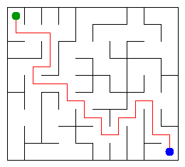

# Assignment 3: Maze Escape

- Student ID: 251941
- Name: Orynbasar Zharkynbek
- Group: SE-2532
- Maze size (rows x columns): 9*10

## Overview

The project represents a maze as a graph. Cells are vertices, and inner walls are edges. DSU builds a connected maze without cycles, Kruskal and Prim find a minimum spanning tree, and DFS finds the exit. Directed slides are divided into strongly connected components, then dynamic programming on the component graph finds the longest chain of zones and the cheapest route.

The implementation uses Java 17 and standard Java collections. No external graph or DSU libraries are used.

## Running

Run the commands from the project folder:

```sh
javac -d out src/*.java
java -cp out Main
```

Main reads `data/walls.txt` and `data/slides.txt`, prints the results and generates `output/maze.png` and `output/maze.html`. Open the HTML file in a browser to view and walk through the maze.

To run the supplied checks and benchmarks:

```sh
java tools/Check.java
java -cp out Bench
```

In IntelliJ IDEA, the main methods of Main, Check, Bench and DisjointSetTest can also be run using the Run button. Run Main again after Check to restore the picture of the personal maze, because Check runs Main on the examples.

## Program output

```text
Broken: 89
Kept: 72
Last broken wall: 141
MST cost: 25085
Heaviest broken wall: 732
Path length: 23
DFS visited: 64
Dead ends: 31
Zones: 12
Largest zone: 14
Is DAG: 0
Flow stages: 7
Fastest route cost: 18
```

## Maze



## Questions

### Mission 0: DSU

`find` returns the root of the set containing a cell, while `union` joins two different sets and returns whether a merge happened. Union by size attaches the smaller tree to the larger one, and path compression makes visited nodes point directly to the root. Together, they give almost constant amortized time per operation.

### Mission 1: Broken and kept walls

There are R*C separate sets initially, and each accepted wall reduces the number of sets by one. Connecting all cells therefore breaks exactly R*C-1 walls. The grid has R*(C-1)+C*(R-1) inner walls, so the number kept is (R-1)*(C-1).

### Mission 2: Kruskal and Prim

For the personal maze, both algorithms return an MST cost of **25085**. Kruskal processes walls in increasing cost order and accepts those joining different components, while Prim repeatedly chooses the cheapest edge leaving its current tree. Both use safe choices according to the cut property, and the distinct wall costs make the MST unique.

### Mission 3: Escape

The maze is connected and contains no cycles, so it is a tree and has exactly one simple path between any two cells. DFS uses an explicit array stack instead of recursion to avoid overflowing the Java call stack on large mazes. Each stack frame tracks its next direction, ensuring that neighbours are tried in the required order: up, right, down, left.

### Mission 4: Zones

Kosaraju first records finishing order using DFS on the original graph, then processes vertices in reverse finishing order on the reversed graph. This ordering lets each second-pass search collect one complete component without entering another unassigned component. Since self loops are excluded, the slides are acyclic exactly when every component contains one cell, meaning Zones equals the number of cells.

### Mission 5: Routes between zones

The component numbers form a topological order: every edge between different zones goes from a smaller number to a larger one. Processing zones in that order is enough to update the longest chain and cheapest distances because all predecessors have already been processed. The pass takes O(Z+E) time, where Z is the number of zones and E is the number of distinct edges between them; building this graph takes expected O(n+m) time using hash maps.

## AI use

ChatGPT was used to help implement the algorithms and DSU tests, explain the solution, check its behaviour and draft the README. The initial implementation and parts of the report were AI-generated.

## Timing (Mission 7)

Measurements from the provided Bench class, in milliseconds, with five runs per algorithm and maze size.

| Maze | Kruskal: five runs | Kruskal average | Prim: five runs | Prim average |
|---|---|---:|---|---:|
| 100 x 100 | 26, 9, 16, 23, 26 | 20 | 21, 16, 14, 6, 11 | 14 |
| 300 x 300 | 163, 145, 86, 67, 112 | 115 | 100, 107, 147, 144, 130 | 126 |
| 1000 x 1000 | 1277, 1223, 1424, 1429, 1252 | 1321 | 2711, 4600, 3143, 2795, 3204 | 3291 |

Both algorithms take more time as the maze grows, consistent with their O(n log n) complexity on a grid. On the largest maze, Kruskal was approximately 2.5 times faster than Prim. Individual measurements vary because of JVM warm-up, garbage collection and system load.

## Complexity

Here, n is the number of cells, m is the number of walls or slides, Z is the number of zones, and E is the number of distinct edges between zones. Space includes data structures created by each algorithm but excludes the original input.

| Algorithm | Time | Space | Assumptions |
|---|---|---|---|
| DSU find and union | O(alpha(n)) amortized per operation | O(n) for the DSU; O(1) per call | Union by size and path compression; initialization O(n) |
| Build maze in file order | O(n + m alpha(n)) | O(n) | Connected rectangular grid |
| Kruskal | O(n + m log m + m alpha(n)) | O(n+m) | Sorting wall indexes and using DSU |
| Prim | O(n + m log(m+1)) | O(n+m) | Lazy priority queue of edges |
| Escape DFS | O(n+m) | O(n+m) | Bounded grid degree; open maze has n-1 edges |
| Kosaraju | O(n+m) | O(n+m) | Two iterative DFS passes and both adjacency lists |
| Zone graph construction and routes | Expected O(n+m+Z+E) | O(Z+E) | Hash maps; route pass alone O(Z+E) |

For a rectangular grid, m=O(n), so Kruskal and Prim both run in O(n log n) time.

## Testing

The supplied Check tool compiles the project and runs DisjointSetTest and three examples. All DSU checks pass, and all 13 output lines match the expected results for `tiny`, `small` and `dag`.

The additional DSU checks cover union with itself, repeated union, an empty DSU, and a chain of 100,000 cells. Additional development checks covered DFS on a 1000 x 1000 maze, Kosaraju and route calculation on a chain of 1,000,000 cells, a single-cell maze, and parallel slides with different costs.
